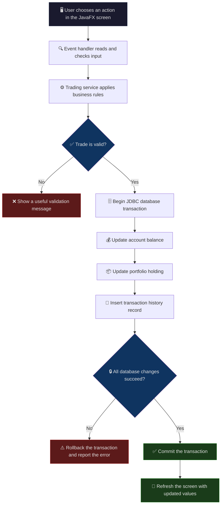
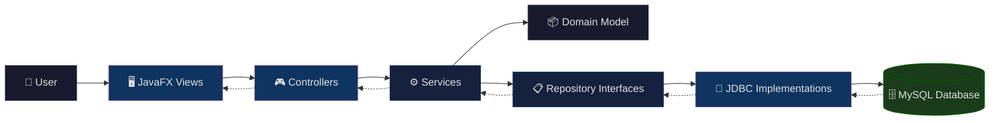
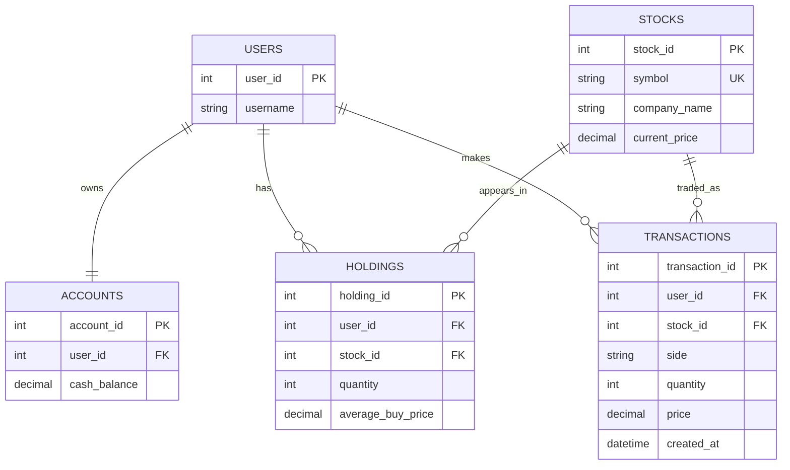
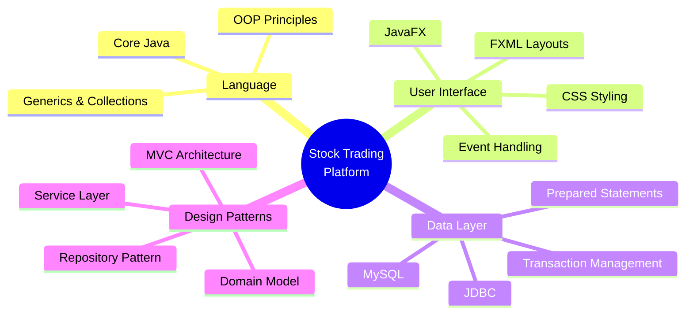

<p align="center">
  
  
  
  
  
</p>

<h1 align="center">📈 Stock Trading Platform</h1>

<p align="center">
  <i>A desktop application for learning how a stock portfolio works — built with Core Java, JavaFX, JDBC & MySQL.</i>
</p>

<p align="center">
  <a href="#-features">Features</a> •
  <a href="#-how-it-works">How It Works</a> •
  <a href="#-trade-lifecycle">Trade Lifecycle</a> •
  <a href="#-architecture">Architecture</a> •
  <a href="#-data-model">Data Model</a> •
  <a href="#-database--persistence">Database</a> •
  <a href="#-getting-started">Getting Started</a> •
  <a href="#-tech-stack">Tech Stack</a>
</p>

---

## 📖 Overview

A desktop application for learning how a stock portfolio works. Users explore a sample market, place simulated buy and sell orders, track their holdings and cash, and review how their portfolio performs over time.

The project brings the ideas in the **Advanced Java Programming** syllabus together in one practical application. It uses Core Java for the trading rules, MySQL and JDBC for durable data, JavaFX for the desktop screens, and Java event handling and collections to connect the parts. It is a **learning simulator** — it does not connect to a real exchange or execute real trades.

> [!NOTE]
> This is an educational simulator. All prices and trades are simulated locally. No real money, live quotes, or broker connectivity is involved.

---

## ✨ Features

| Feature | Description |
|:--------|:------------|
| 📊 **Market Catalog** | Displays a catalog of sample stocks and their current simulated prices |
| 🛒 **Buy Shares** | Lets a user buy shares when their account has enough cash |
| 💰 **Sell Shares** | Sell shares the user owns at the current market price |
| 💼 **Portfolio Tracking** | Maintains cash balance, share quantity, average purchase price, and trade history |
| 📈 **P/L Analysis** | Shows portfolio value and realized and unrealized profit or loss |
| 🔄 **Price Simulation** | Updates sample prices to demonstrate how market changes affect a portfolio |
| 💾 **Persistent Storage** | Saves application data in a MySQL database so it is available after restarting |
| 🖥️ **Desktop Interface** | Presents features through a desktop interface with forms, lists, controls, and event-driven actions |

---

## 🔍 How It Works

### Where the Data Comes From

The market is seeded with sample stock symbols, company names, and starting prices. The application generates simulated price changes locally; it does not fetch live prices from an external API. This keeps the project self-contained and lets users safely experiment with trades.

When a user performs an action, the interface passes the request to the application logic. The logic checks the trade rules, updates the account and portfolio, and records the transaction through JDBC. MySQL stores the market, account, holdings, and transaction records in related tables. When the application starts, it reads the saved records back into the application so the user can continue.

---

## 🔄 Trade Lifecycle

The diagram below shows the end-to-end flow of a trade through the application:



**Trade validation rules:**

- **Purchase** — checks that the quantity is positive and the account has enough cash.
- **Sale** — checks that the user owns enough shares.
- A successful trade updates the cash balance, portfolio holding, and transaction history as one database transaction, preventing a partial trade from being saved if an error occurs.
- The interface then displays the updated balance, holdings, or trade receipt.

---

## 🏗️ Architecture

The code separates the screen, application rules, and database access. The screen handles display and input. Services coordinate actions such as buying, selling, and calculating performance. Domain classes represent accounts, stocks, holdings, portfolios, and transactions. JDBC data access classes load and save those objects.

> [!TIP]
> This separation keeps trading rules independent from the interface and storage details, and gives the project clear seams for later migration to a framework such as Spring.

### Project Structure

```
StockTradingPlatform/
├── 📂 src/
│   ├── 📂 main/
│   │   ├── 📂 java/com/stockplatform/
│   │   │   ├── 📂 app/
│   │   │   │   ├── StockTradingApplication.java  ─── JavaFX entry point and startup
│   │   │   │   └── ApplicationContext.java       ─── Creates and connects app components
│   │   │   │
│   │   │   ├── 📂 config/
│   │   │   │   ├── DatabaseConfig.java           ─── Reads MySQL connection settings
│   │   │   │   └── AppConfig.java                ─── Shared application configuration
│   │   │   │
│   │   │   ├── 📂 domain/
│   │   │   │   ├── User.java                     ─── User identity and account ownership
│   │   │   │   ├── Account.java                  ─── Cash balance and account operations
│   │   │   │   ├── Stock.java                    ─── Symbol, company, and current price
│   │   │   │   ├── Holding.java                  ─── Quantity and average purchase price
│   │   │   │   ├── Portfolio.java                ─── Holdings and valuation calculations
│   │   │   │   ├── Transaction.java              ─── Buy/sell record and timestamp
│   │   │   │   └── TradeType.java                ─── BUY and SELL trade sides
│   │   │   │
│   │   │   ├── 📂 exception/
│   │   │   │   ├── InsufficientFundsException.java  ─── Purchase validation failure
│   │   │   │   ├── InsufficientSharesException.java ─── Sale validation failure
│   │   │   │   └── DataAccessException.java         ─── Persistence failure boundary
│   │   │   │
│   │   │   ├── 📂 repository/
│   │   │   │   ├── UserRepository.java           ─── Account/user data contract
│   │   │   │   ├── StockRepository.java          ─── Market catalog data contract
│   │   │   │   ├── PortfolioRepository.java      ─── Holdings data contract
│   │   │   │   └── TransactionRepository.java    ─── Trade history data contract
│   │   │   │
│   │   │   ├── 📂 repository/jdbc/
│   │   │   │   ├── JdbcUserRepository.java       ─── MySQL user/account queries
│   │   │   │   ├── JdbcStockRepository.java      ─── MySQL stock queries
│   │   │   │   ├── JdbcPortfolioRepository.java  ─── MySQL holding queries
│   │   │   │   ├── JdbcTransactionRepository.java ── MySQL transaction queries
│   │   │   │   ├── JdbcConnectionFactory.java    ─── Opens JDBC connections
│   │   │   │   └── JdbcTransactionRunner.java    ─── Commit/rollback support
│   │   │   │
│   │   │   ├── 📂 service/
│   │   │   │   ├── TradingService.java           ─── Validates and executes trades
│   │   │   │   ├── MarketService.java            ─── Market listing and price simulation
│   │   │   │   ├── PortfolioService.java         ─── Portfolio and P/L calculations
│   │   │   │   └── AccountService.java           ─── Balance and account operations
│   │   │   │
│   │   │   ├── 📂 ui/
│   │   │   │   ├── 📂 controller/
│   │   │   │   │   ├── DashboardController.java  ─── Dashboard actions and refresh
│   │   │   │   │   ├── TradeController.java      ─── Buy/sell form event handling
│   │   │   │   │   ├── PortfolioController.java  ─── Holdings view actions
│   │   │   │   │   └── HistoryController.java    ─── Transaction history actions
│   │   │   │   ├── 📂 view/
│   │   │   │   │   ├── DashboardView.java        ─── Main window and navigation
│   │   │   │   │   ├── MarketView.java           ─── Market table and price view
│   │   │   │   │   ├── TradeView.java            ─── Order entry form
│   │   │   │   │   ├── PortfolioView.java        ─── Holdings and performance
│   │   │   │   │   └── HistoryView.java          ─── Transaction table
│   │   │   │   └── 📂 component/
│   │   │   │       ├── NavigationBar.java        ─── Reusable navigation component
│   │   │   │       └── NotificationPane.java     ─── Status and error messages
│   │   │   │
│   │   │   └── 📂 util/
│   │   │       ├── MoneyFormatter.java           ─── Consistent currency display
│   │   │       ├── InputValidator.java           ─── Shared UI input checks
│   │   │       └── DateTimeFormatterUtil.java    ─── Transaction date formatting
│   │   │
│   │   └── 📂 resources/
│   │       ├── 📂 fxml/
│   │       │   ├── dashboard.fxml                ─── Dashboard layout
│   │       │   ├── market.fxml                   ─── Market screen layout
│   │       │   ├── trade.fxml                    ─── Trade screen layout
│   │       │   ├── portfolio.fxml                ─── Portfolio screen layout
│   │       │   └── history.fxml                  ─── History screen layout
│   │       ├── 📂 css/
│   │       │   └── application.css               ─── Desktop theme and styling
│   │       └── 📂 db/
│   │           ├── schema.sql                    ─── MySQL tables, keys, and constraints
│   │           └── seed.sql                      ─── Initial sample stocks and prices
│   │
│   └── 📂 test/java/com/stockplatform/
│       ├── 📂 service/                           ─── Trading and portfolio rule tests
│       └── 📂 repository/                        ─── JDBC persistence tests
│
├── 📂 config/
│   └── application.example.properties            ─── Safe configuration template
├── 📂 data/                                      ─── Optional exports and local runtime files
├── pom.xml                                       ─── Build and JavaFX/MySQL driver dependencies
├── .env.example                                  ─── Example MySQL environment variables
├── .gitignore                                    ─── Excludes build output and private config
└── README.md                                     ─── Project guide
```

The package tree shows how responsibilities fit together. `ui` gathers input and displays output, `service` enforces trading rules, `domain` represents the financial concepts, and `repository` defines the storage boundary. The `repository/jdbc` classes execute MySQL queries. Resource files provide screen layouts, styles, schema creation, and seed data. Configuration templates document required settings without containing real passwords. The exact class names can evolve with the implementation while these boundaries remain useful.

### Layer Interaction



The user sees JavaFX screens and receives clear feedback. Controllers translate clicks and form submissions into service calls. Services apply rules using domain objects, then use repository contracts to load or save information. JDBC implementations translate those contracts into SQL. Results travel back up through the same layers to refresh the screen.

---

## 📐 Data Model

### Core Concepts

| Concept | Role |
|:--------|:-----|
| 💳 **Account** | Holds the user's cash balance and links the user's financial activity |
| 📊 **Stock** | Describes a tradable sample instrument and its latest simulated price |
| 📦 **Holding** | Records how many shares the user owns and their average purchase price |
| 💼 **Portfolio** | Collects holdings and calculates current value and unrealized profit/loss |
| 📝 **Transaction** | Records each buy or sell with quantity, execution price, amount, and time |
| 🔄 **Market Service** | Provides the stock catalog and simulated price updates |
| ⚙️ **Trading Service** | Validates and coordinates a purchase or sale |
| 🗄️ **Repository** | Loads and saves application data; JDBC repositories implement this boundary |

### Sample Market Data

The application ships with a curated set of well-known tech stocks:

| Symbol | Company | Starting Price |
|:-------|:--------|---------------:|
| `AAPL` | Apple Inc. | $225.00 |
| `GOOGL` | Alphabet Inc. | $250.00 |
| `MSFT` | Microsoft Corp. | $500.00 |
| `AMZN` | Amazon.com Inc. | $230.00 |
| `TSLA` | Tesla Inc. | $450.00 |
| `META` | Meta Platforms | $600.00 |
| `NFLX` | Netflix Inc. | $700.00 |

---

## 🗄️ Database & Persistence

MySQL stores the application's data in relational tables. JDBC provides the standard Java connection and SQL APIs used to communicate with the database. The application initializes the schema and sample market records, then uses prepared statements to read and update rows. Connection details come from local configuration or environment variables rather than source code.

The relational model centers on users, accounts, stocks, holdings, and transactions. A holding belongs to a user and a stock; a transaction identifies the account, stock, trade side, quantity, price, and timestamp. Keys and constraints keep records connected and prevent invalid quantities. A trade updates the account, holding, and transaction record together inside one JDBC transaction. Database configuration and private user data stay out of source control.

### Entity Relationship Diagram



---

## 🎓 Advanced Java Syllabus in Practice

The project uses syllabus topics as working parts of the application:

<table>
<thead>
  <tr>
    <th width="30%">Syllabus Area</th>
    <th>Use in the Project</th>
  </tr>
</thead>
<tbody>
  <tr>
    <td><strong>Java Fundamentals</strong><br/><sub>Classes, objects, constructors, methods, <code>this</code>, <code>static</code>, access control</sub></td>
    <td>Build and protect the domain model and application components.</td>
  </tr>
  <tr>
    <td><strong>Inheritance & Polymorphism</strong><br/><sub>Abstract classes, interfaces, <code>super</code>, <code>final</code></sub></td>
    <td>Share behavior where appropriate and define contracts between UI, services, and repositories.</td>
  </tr>
  <tr>
    <td><strong>Compile-time & Runtime Polymorphism</strong></td>
    <td>Overload useful operations and let implementations satisfy service or repository interfaces.</td>
  </tr>
  <tr>
    <td><strong>Exception Handling</strong><br/><sub>Custom exceptions, <code>try</code>/<code>catch</code>/<code>finally</code>, resource cleanup</sub></td>
    <td>Handle invalid trades, database errors, and file or stream failures safely.</td>
  </tr>
  <tr>
    <td><strong>Concurrency</strong><br/><sub>Threads, <code>Runnable</code>, synchronization, inter-thread communication</sub></td>
    <td>Keep longer-running work such as database operations or market refreshes from blocking the interface, and coordinate shared state safely.</td>
  </tr>
  <tr>
    <td><strong>I/O Streams & File Handling</strong></td>
    <td>Read setup/configuration resources and manage local application data where needed.</td>
  </tr>
  <tr>
    <td><strong>Event Model</strong><br/><sub>Event classes, listeners, adapter classes</sub></td>
    <td>Respond to JavaFX control events and keep input handling separate from business logic.</td>
  </tr>
  <tr>
    <td><strong>JDBC & Databases</strong></td>
    <td>Connect to MySQL and perform CRUD operations with prepared statements; the syllabus's JDBC/SQLite connectivity concepts transfer directly to the selected MySQL database.</td>
  </tr>
  <tr>
    <td><strong>Collections</strong><br/><sub><code>List</code>, <code>Set</code>, <code>Map</code>, <code>ArrayList</code>, <code>LinkedList</code>, <code>HashMap</code>, <code>TreeMap</code>, iterators</sub></td>
    <td>Store and process market listings, holdings, and transaction collections.</td>
  </tr>
  <tr>
    <td><strong>Generics</strong><br/><sub>Generic classes, methods, interfaces, wildcard arguments, hierarchies</sub></td>
    <td>Reuse type-safe components and define flexible contracts without losing compile-time type checks.</td>
  </tr>
  <tr>
    <td><strong>JavaFX</strong><br/><sub>Applications and controls</sub></td>
    <td>Present the desktop application with forms, text fields, lists, combo boxes, radio buttons, menus, and other controls.</td>
  </tr>
</tbody>
</table>

> [!IMPORTANT]
> The desktop UI uses JavaFX, while event handling, database access, collections, concurrency, and domain behavior use Java and JDBC concepts from the syllabus. The project does **not** use Spring or Spring Boot.

---

## 🛠️ Tech Stack



---

## 🚀 Getting Started

### Prerequisites

| Requirement | Details |
|:------------|:--------|
| ☕ **JDK** | A JDK compatible with the JavaFX version used by the project |
| 🖥️ **JavaFX SDK** | JavaFX SDK or the configured JavaFX build/runtime dependencies |
| 🗄️ **MySQL Server** | MySQL Server and a database/schema for the application |
| 🔌 **JDBC Driver** | MySQL Connector/J JDBC driver |
| 🔧 **Build Tool / IDE** | A supported build tool or IDE launch configuration that includes JavaFX and MySQL dependencies |
| 🔑 **DB Config** | Database connection settings supplied through environment variables or a private local configuration file |

> [!WARNING]
> The project uses Core Java, JavaFX, JDBC, and MySQL. It does **not** require a web server, broker account, live market API, or Spring framework.

### Build & Run

1. **Clone the repository**
   ```bash
   git clone https://github.com/<your-username>/SankalpT23_StockTradingPlatform.git
   cd SankalpT23_StockTradingPlatform
   ```

2. **Configure the database**
   - Copy `.env.example` to `.env` and fill in your MySQL connection details
   - Or configure `config/application.properties` from the template

3. **Open in your IDE**
   - Import the project with the required JDK, JavaFX runtime, and MySQL Connector/J
   - Ensure JavaFX module setup is configured

4. **Run the application**
   - Execute the application entry point from your project configuration
   - The application connects to MySQL, initializes sample market data when needed, and opens the trading interface

> [!NOTE]
> Exact command-line build instructions depend on the repository's build configuration and JavaFX module setup. Configure MySQL Connector/J, JavaFX libraries, and database settings in that setup before launching the desktop application.

---

## 🎯 Purpose & Scope

The project makes the flow of a basic investment portfolio visible: a user starts with cash, buys or sells sample shares, and sees how each action changes their holdings and account value. It provides a practical setting for learning:

- 🏗️ **Object-Oriented Design** — domain modeling with real financial concepts
- 🖥️ **Desktop Event Handling** — responsive UI with JavaFX
- 📦 **Collections & Generics** — type-safe data management
- ⚡ **Concurrency** — non-blocking operations
- 🛡️ **Exception Handling** — graceful error recovery
- 🗄️ **Relational Persistence** — durable data with JDBC & MySQL

> [!CAUTION]
> Prices and trades are simulated for education. The application does **not** provide financial advice, live quotes, broker connectivity, or real-money trading.

---
